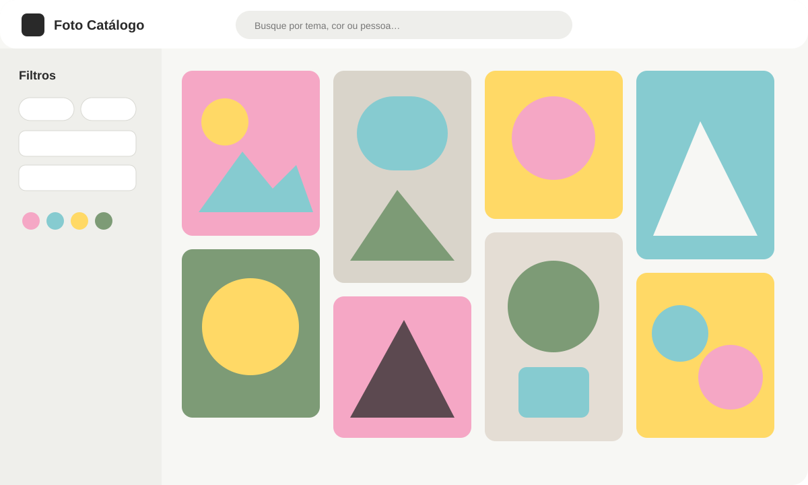
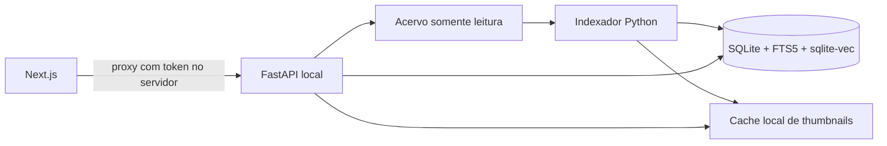

# Catálogo Visual de Fotos

Aplicação local para organizar e pesquisar grandes acervos fotográficos por texto,
metadados, cores predominantes e similaridade visual. O projeto combina FastAPI,
SQLite/FTS5, `sqlite-vec`, embeddings CLIP e uma interface Next.js inspirada em
galerias visuais.



> Desenvolvido originalmente para uso interno da MOOUI. O projeto foi adaptado e
> publicado para fins de estudo e compartilhamento de arquitetura.

Esta versão pública não contém fotografias, banco de dados, credenciais, nomes de
parceiros, endereços de rede nem ativos oficiais da MOOUI. A marca MOOUI é citada
apenas para contextualizar a origem do projeto e não faz parte da licença do código.

## Recursos

- indexação incremental e somente leitura do acervo original;
- busca textual com SQLite FTS5;
- embeddings CLIP de 512 dimensões armazenados com `sqlite-vec`;
- pesquisa por imagem enviada, arrastada ou colada;
- paleta dominante e famílias de cores configuráveis;
- filtros combináveis por ano, tipo, coleção, pessoa, perfil, ambiente, cor,
  orientação, presença de pessoa/modelo e direitos de uso;
- filtros negativos (`pessoa_tipo=!modelo`) e rejeição de parâmetros desconhecidos;
- `GET /capabilities` descrevendo filtros e modos de busca para integrações;
- paginação, ordenação e imagens semelhantes;
- cache local de thumbnails, sem escrever no compartilhamento;
- download opcional do original;
- API interna protegida por token e acessada pela interface através de proxy.

## Arquitetura



O navegador nunca recebe `CATALOGO_API_TOKEN`. O Route Handler do Next.js adiciona
o token ao encaminhar requisições para a API, que por padrão escuta apenas em
`127.0.0.1`.

## Requisitos

- Python 3.11 ou superior;
- Node.js 20 ou superior;
- SQLite com suporte a extensões;
- acesso somente leitura ao diretório de fotografias;
- WSL e `cifs-utils` apenas quando o acervo estiver em um compartilhamento SMB no
  Windows.

O processamento CLIP instala PyTorch e pode consumir alguns gigabytes. Para testar
somente parser, banco e API, instale apenas os extras necessários.

## Instalação

```bash
python3 -m venv .venv
source .venv/bin/activate
pip install -e ".[api,visual,dev]"

cd web
npm install
cd ..
```

Inicialize o banco e indexe uma pasta de fotografias:

```bash
python scripts/init_db.py catalog.db
python scripts/scan_metadata.py /mnt/photo-library/photos --db catalog.db
python scripts/process_visual.py --db catalog.db --batch-size 16
```

O indexador valida montagens CIFS como somente leitura. Em testes com diretórios
locais, use as funções Python com `verificar_readonly=False`; não desative essa
proteção no acervo real.

## Execução manual

Gere um token longo e use o mesmo valor na API e no processo Next.js:

```bash
export CATALOGO_API_TOKEN="$(python -c 'import secrets; print(secrets.token_urlsafe(32))')"
export CATALOGO_DB="catalog.db"
python scripts/run_api.py
```

Em outro terminal:

```bash
cd web
export API_INTERNAL_URL="http://127.0.0.1:8000"
export CATALOGO_API_TOKEN="cole-aqui-o-mesmo-token"
npm run dev -- -p 7777
```

Acesse `http://localhost:7777`.

## Inicialização no Windows/WSL

Copie o exemplo, preencha apenas localmente e nunca versione o resultado:

```powershell
Copy-Item config.example.ps1 config.local.ps1
.\scripts\start_catalogo.ps1
```

`config.local.ps1` controla caminhos, montagem SMB, arquivo de credenciais, banco,
URL local e token. Ele já está bloqueado pelo `.gitignore`.

## Configuração

As configurações do catálogo vivem na tabela `config`, criada por
`src/catalogo/seeds.sql`. Caminhos de implantação e segredos ficam fora do banco de
exemplo, em variáveis de ambiente ou `config.local.ps1`.

Variáveis principais:

| Variável | Finalidade |
|---|---|
| `CATALOGO_DB` | Caminho do SQLite |
| `CATALOGO_HOST` | Host da API; padrão `127.0.0.1` |
| `CATALOGO_PORT` | Porta da API |
| `CATALOGO_API_TOKEN` | Token obrigatório da API |
| `CATALOGO_CORS_ORIGINS` | Origens permitidas, separadas por vírgula |
| `API_INTERNAL_URL` | URL da API vista pelo servidor Next.js |
| `ALLOWED_DEV_ORIGINS` | Hosts permitidos pelo Next.js em desenvolvimento |

## Segurança e privacidade

- não exponha a aplicação diretamente à internet;
- mantenha o compartilhamento em modo somente leitura;
- use autenticação de usuários na borda caso disponibilize a interface fora de uma
  rede confiável;
- não publique bancos, thumbnails, logs, credenciais ou acervos de demonstração;
- revise direitos autorais e consentimentos antes de processar fotografias.

Consulte [SECURITY.md](SECURITY.md) para detalhes.

## Testes

```bash
pytest -q
ruff check src tests scripts

cd web
npm run build
```

## Estrutura

```text
src/catalogo/       núcleo, banco, parser, busca, API e processamento visual
scripts/            CLIs de indexação, manutenção e inicialização
tests/              testes com arquivos e nomes fictícios
web/                interface Next.js e proxy protegido
docs/               materiais públicos de apresentação
```

## Roadmap

- coleta opcional e anônima de sinais locais de relevância;
- autenticação de usuários integrada para implantações compartilhadas;
- dataset de demonstração totalmente sintético;
- empacotamento com contêineres;
- auditoria e recuperação assistida de arquivos inválidos.

## Licença

O código está disponível sob a [licença MIT](LICENSE). Nomes comerciais, marcas,
fotografias e outros ativos de terceiros não são licenciados por este repositório.
